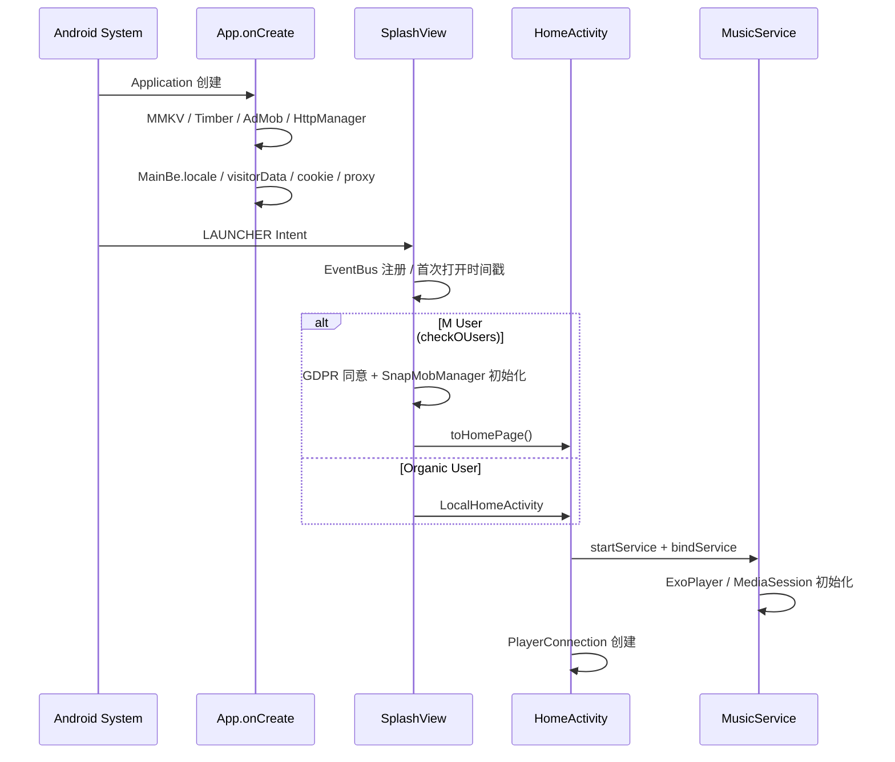

# MusicSnap 项目技术文档（完整版）

> **包名**：`com.snap.intelligence.musics`  
> **工程名**：MusicSnap（`settings.gradle.kts`）  
> **版本**：1.0.3 / versionCode 4  
> **SDK**：minSdk 24 · targetSdk 35 · compileSdk 35 · JVM 17

---

## 目录

1. [项目概述](#1-项目概述)
2. [技术栈与依赖](#2-技术栈与依赖)
3. [应用启动与生命周期](#3-应用启动与生命周期)
4. [模块架构](#4-模块架构)
5. [完整目录与文件索引](#5-完整目录与文件索引)
6. [UI 层详解](#6-ui-层详解)
7. [ViewModel 层](#7-viewmodel-层)
8. [播放系统（核心）](#8-播放系统核心)
9. [innertube 网络层](#9-innertube-网络层)
10. [数据库设计](#10-数据库设计)
11. [用户配置（DataStore）](#11-用户配置datastore)
12. [本地音乐模块](#12-本地音乐模块)
13. [广告、归因与远程配置](#13-广告归因与远程配置)
14. [扩展函数与工具类](#14-扩展函数与工具类)
15. [错误处理与边界情况](#15-错误处理与边界情况)
16. [构建与扩展开发](#16-构建与扩展开发)

---

## 1. 项目概述

### 1.1 产品定位

MusicSnap 是一款 **Android 音乐流媒体 + 本地播放** 应用。在线内容通过 **YouTube Music InnerTube 非公开 API** 获取（不依赖官方 SDK），本地内容通过 **MediaStore** 扫描设备音频文件。播放引擎基于 **Media3 ExoPlayer**，以后台 `MusicService` 为核心，UI 通过 `PlayerConnection` 桥接。

代码 lineage 来自 ViMusic / OuterTune 生态：`innertube` 模块注释中明确标注修改自 ViMusic；`MusicPlayerUtils` 标注来自 OuterTune Project。

### 1.2 功能矩阵

| 功能 | 实现方式 | 关键类 |
|------|----------|--------|
| 首页推荐 | `MainBe.home()` | `HomeViewModel`, `HomePageSectionsAdapter` |
| 探索/新专辑 | `MainBe.explore()` | `NewReleaseAlbumsAdapter`, `ExplorePage` |
| 心情与流派 | `MainBe.moodAndGenres()` | `MoodAndGenresAdapter`, `MoodDetailsActivity` |
| 搜索 | `MainBe.search()` / `searchSuggestions()` | `MusicSearchActivity`, `VideoSongAdapter` |
| 艺术家/专辑/歌单 | `MainBe.browse()` / `album()` / `playlist()` | `ArtistDetActivity`, `AlbumDetActivity`, `PlayListDetActivity` |
| 在线播放 | ExoPlayer + ResolvingDataSource | `MusicService`, `MusicPlayerUtils` |
| 播放队列/Radio | `MainBe.next()` | `YouTubeQueue`, `YouTubeAlbumRadio` |
| 收藏/历史 | Room | `CollectActivity`, `HistoryActivity` |
| 本地扫描 | MediaStore + MMKV 缓存 | `MusicScanner`, `LocalSongsFragment` |
| 后台播放/通知 | MediaLibraryService | `MusicService`, `MediaLibrarySessionCallback` |
| Android Auto | MediaLibrary 浏览树 | `MediaLibrarySessionCallback.onGetChildren` |
| Discord 状态 | kizzy WebSocket | `DiscordRPC` |
| 广告 | AdMob | `SnapMobManager` |
| 归因 | AppsFlyer + Install Referrer | `App.initAppFly()`, `initReferInfos()` |

### 1.3 双入口设计

应用存在 **两条用户路径**，由 `checkOUsers()` / `MUSIC_CONSTANT_IS_M_USER` 控制：

| 路径 | 入口 Activity | 说明 |
|------|---------------|------|
| 在线用户（M User） | `SplashView` → `HomeActivity` | 完整 YouTube Music 功能 + 广告 |
| 有机用户（Organic） | `SplashView` → `LocalHomeActivity` | 以本地音乐为主，跳过部分广告初始化 |

`App.isLocal` 标志区分本地模式，影响队列持久化等行为。

---

## 2. 技术栈与依赖

### 2.1 核心依赖版本（`gradle/libs.versions.toml`）

| 库 | 版本 | 用途 |
|----|------|------|
| Kotlin | 2.0.10 | 语言 |
| AGP | 8.6.0 | 构建 |
| Media3 ExoPlayer | 1.4.1 | 播放 |
| Media3 Session | 1.4.1 | 媒体会话/通知 |
| Room | 2.6.1 | 本地 DB |
| Hilt | 2.51.1 | DI |
| Ktor | 2.3.12 | innertube HTTP |
| NewPipe Extractor | v0.25.1 | URL 签名解密 |
| Coil | 2.6.0 | Application 级图片 |
| Glide | 4.15.1 | Activity 级图片 |
| DataStore | 1.1.1 | 偏好设置 |
| MMKV | 1.3.14 | 高性能 KV |
| Timber | 5.0.1 | 日志 |

### 2.2 Gradle 模块依赖图

```
:app
 ├── :innertube     (api: YouTube InnerTube)
 ├── :kizzy         (api: Discord RPC)
 └── [未接入] :kugou (歌词 API，settings 已 include 但 app 未 implementation)
```

---

## 3. 应用启动与生命周期

### 3.1 冷启动时序



### 3.2 Application 初始化细节（`App.kt`）

**同步初始化：**

```kotlin
MMKV.initialize(this)
Timber.plant(Timber.DebugTree())  // DEBUG only
initManager()  // MobileAds + HttpManager + Referrer + AppsFlyer
MainBe.locale = YouTubeLocale(gl, hl)  // 从 DataStore 或系统 Locale
MainBe.proxy = ...  // 可选 HTTP 代理
MainBe.useLoginForBrowse = ...
```

**异步监听（GlobalScope）：**

- `VisitorDataKey` → `MainBe.visitorData`（匿名会话 ID，首次自动调用 `MainBe.visitorData()` API 获取）
- `InnerTubeCookieKey` → `MainBe.cookie`（登录 Cookie，含 SAPISIDHASH 鉴权）

**ImageLoader（Coil）：**

- 磁盘缓存目录：`cacheDir/coil`
- 大小：`MaxImageCacheSizeKey`（默认 512MB）
- `allowHardware`：API 28+

**后台行为：**

- `onBackground`：2 秒内防抖后 `ActivityUtils.finishAllActivities()`（商业逻辑）
- `onTrimMemory`：预留清理逻辑（已注释）

### 3.3 Activity 与 Service 绑定

`HomeActivity` / `LocalHomeActivity` 在 `onStart()` 中：

```kotlin
startService(Intent(this, MusicService::class.java))
bindService(Intent(this, MusicService::class.java), serviceConnection, BIND_AUTO_CREATE)
```

`ServiceConnection.onServiceConnected` 创建全局单例：

```kotlin
playerConnection = PlayerConnection(this, service as MusicBinder, database, lifecycleScope)
```

`onStop()` / `onServiceDisconnected` 调用 `playerConnection.dispose()` 并置 null。

---

## 4. 模块架构

### 4.1 分层职责

```
┌──────────────────────────────────────────────────────────────────┐
│ Presentation                                                      │
│  Activity + ViewBinding + RecyclerView Adapter                   │
│  ViewModel (Hilt) ← MainBe / MusicDatabase                       │
│  playerConnection (全局播放器状态 Flow)                            │
├──────────────────────────────────────────────────────────────────┤
│ Playback Domain                                                   │
│  MusicService ← Queue 策略 ← PlayerConnection                    │
│  ExoPlayer + ResolvingDataSource + SimpleCache×2                 │
├──────────────────────────────────────────────────────────────────┤
│ Data                                                              │
│  innertube (Ktor → music.youtube.com/youtubei/v1/)               │
│  MusicPlayerUtils (Client 选择 + NewPipe + PoToken)              │
│  Room (歌曲/历史/格式/关联) + DataStore + MMKV                     │
└──────────────────────────────────────────────────────────────────┘
```

### 4.2 数据流：从 API 到 UI

```
InnerTube JSON Response
    → pages/*.kt 解析为 SongItem / AlbumItem / HomePage ...
    → SongItem.toMediaMetadata() 转为 app 层 MediaMetadata
    → MediaMetadata.toMediaItem() 转为 ExoPlayer MediaItem
    → MusicService 播放
    → PlayerConnection.mediaMetadata Flow
    → MainPlayer / HomeActivity 底部 Mini Player 更新 UI
```

**注意**：存在两个 `MediaMetadata` 类型：

- `com.snap.intelligence.musics.models.MediaMetadata` — 业务模型，存在 `MediaItem.localConfiguration.tag`
- `androidx.media3.common.MediaMetadata` — ExoPlayer 系统元数据（title/artist/artworkUri）

---

## 5. 完整目录与文件索引

### 5.1 app 模块 — 按包分类（144 个 Kotlin 文件）

#### `playback/` — 播放核心（16 文件）

| 文件 | 职责 |
|------|------|
| `MusicService.kt` | 前台 Service；ExoPlayer 生命周期；ResolvingDataSource；队列调度；持久化；Discord RPC |
| `PlayerConnection.kt` | UI 侧播放器代理；暴露 StateFlow；转发 playQueue/playNext/addToQueue |
| `MusicPlayerUtils.kt` | 多 Client 流 URL 解析；音质选择；URL 验证 |
| `Po.kt` | `PoTokenGenerator`；WebView 生命周期管理；streamingPot + playerPot |
| `SnapTokenWebView.kt` | WebView + JS；BotGuard；integrityToken；generatePoToken |
| `SnapTokenException.kt` | PoToken 相关异常（`BadWebViewException`, `PoTokenException`） |
| `MusicTokenResult.kt` | `(playerRequestPoToken, streamingDataPoToken)` 数据类 |
| `ChallengeData.kt` | BotGuard challenge 解析 |
| `MediaLibrarySessionCallback.kt` | MediaSession 回调；Android Auto 媒体库树；自定义命令 |
| `SleepTimer.kt` | 睡眠定时器；支持 N 分钟后暂停 / 本曲结束暂停 |
| `queues/Queue.kt` | Queue 接口 + explicit 过滤扩展 |
| `queues/YouTubeQueue.kt` | YouTube Radio/歌单队列；`MainBe.next()` |
| `queues/YouTubeAlbumRadio.kt` | 专辑全曲 + Radio 续播 |
| `queues/ListQueue.kt` | 静态列表队列 |
| `queues/LocalAlbumRadio.kt` | 本地专辑随机 |
| `queues/EmptyQueue.kt` | 空闲占位 |

#### `ui/` — 界面层

| 路径 | 文件 | 职责 |
|------|------|------|
| `ui/start/` | `SplashView.kt` | 启动页；GDPR；路由到 Home/Local |
| | `HomeActivity.kt` | 在线首页；绑定 Service；底部播放器 |
| `ui/music/` | `MainPlayer.kt` | 全屏播放页；SeekBar；封面动画；收藏 |
| `ui/search/` | `MusicSearchActivity.kt` | 在线搜索 |
| | `MusicSearchHistoryActivity.kt` | 搜索历史 |
| | `adapter/VideoSongAdapter.kt` | 搜索结果歌曲列表 |
| `ui/artist/` | `ArtistDetActivity.kt` | 艺术家主页 |
| | `ArtistItemActivity.kt` | 艺术家子 tab（歌曲/专辑/…） |
| `ui/album/` | `AlbumDetActivity.kt` | 专辑详情 |
| | `AlbumAdapter.kt` | 专辑歌曲列表 |
| `ui/playlist/` | `PlayListDetActivity.kt` | 在线歌单 |
| `ui/queue/` | `QueueActivity.kt` | 播放队列编辑 |
| `ui/collect/` | `CollectActivity.kt` | 收藏列表 |
| `ui/history/` | `HistoryActivity.kt` | 播放历史 |
| `ui/about/` | `AboutView.kt`, `BroView.kt` | 关于页 |

#### `local/` — 本地音乐

| 文件 | 职责 |
|------|------|
| `LocalHomeActivity.kt` | 本地首页；Tab+ViewPager；绑定 MusicService |
| `LocalMusicPlayerActivity.kt` | 本地播放页（布局与 MainPlayer 共用 `ActLoPlayerBinding`） |
| `LocalPlayListActivity.kt` | 本地歌单 |
| `SongListActivity.kt` | 歌曲列表 |
| `MusicScanner.kt` | MediaStore 扫描 |
| `DataKeeper.kt` | MMKV 持久化本地歌曲列表 |
| `kt.kt` | `playLocalMusic()` — 构建 content:// MediaItem + ListQueue |
| `toMediaMetadata.kt` | 本地 Song → MediaMetadata |
| `frag/LocalSongsFragment.kt` | 本地歌曲 Tab |
| `frag/AlbumsFragment.kt` | 专辑 Tab |
| `frag/ArtistsFragment.kt` | 艺术家 Tab |
| `frag/CollectFragment.kt` | 收藏 Tab |

#### `db/` — 数据库

| 文件 | 职责 |
|------|------|
| `VerDatabase.kt` | `@Database` 定义；Migration；`MusicDatabase` 包装类 |
| `DatabaseDao.kt` | 全部 DAO 查询（800+ 行） |
| `InternalDatabase.kt` | Room 实例工厂 |
| `Converters.kt` | 类型转换器 |
| `entities/*.kt` | 13 个 Entity + 3 个 View |

#### `viewmodels/` — 15 个 ViewModel

见 [第 7 节](#7-viewmodel-层)。

#### `extensions/` — 扩展函数

| 文件 | 内容 |
|------|------|
| `VerMediaItemExt.kt` | `MediaItem.metadata`；`toMediaItem()` |
| `VerPlayerExt.kt` | `togglePlayPause`；`getQueueWindows`；`currentMetadata` |
| `VerCoroutineExt.kt` | Flow collect 封装 |
| `VerUtilExt.kt` | 通用工具扩展 |
| `VerStringExt.kt` | 字符串处理 |
| `VerFileExt.kt` | 文件操作 |
| `VerFireBase.kt` | Firebase 事件 |

#### 其他包

| 包 | 说明 |
|----|------|
| `constants/` | `PreferenceKeys.kt`（DataStore Key + 枚举）；`SnapPosManager.kt`（广告位）；`Dimensions.kt` |
| `di/` | `VerAppModule.kt` — Hilt 提供 DB 和双缓存 |
| `mob/` | `SnapMobManager.kt` — AdMob 封装；`KepingValueTools.kt` |
| `models/` | `MediaMetadata.kt`；`PersistQueue.kt`；`ItemsPage.kt` |
| `utils/` | `DataStore.kt`；`NetworkUtils.kt`；`DiscordRPC.kt`；`CoilBitmapLoader.kt` |
| `work/` | `HttpManager.kt` — 业务后端 HTTP；`SnapBasicInterfaces.kt` — 远程配置 |
| `flow/` | 自定义 LayoutManager |

#### 根目录 Adapter / Activity

| 文件 | 用途 |
|------|------|
| `HomePageSectionsAdapter.kt` | 首页推荐区块 |
| `NewReleaseAlbumsAdapter.kt` | 新专辑横向列表 |
| `MoodAndGenresAdapter.kt` | 心情流派 |
| `SongListAdapter.kt` | 通用歌曲列表 |
| `NewReleaseDetailsActivity.kt` | 新专辑详情 |
| `MoodDetailsActivity.kt` | 流派详情 |
| `BasicView.kt` | Activity 基类 |

---

## 6. UI 层详解

### 6.1 AndroidManifest Activity 注册

| Activity | launchMode | 说明 |
|----------|------------|------|
| `SplashView` | standard | LAUNCHER；`APP_MUSIC` category |
| `HomeActivity` | singleTask | 在线主页 |
| `MainPlayer` | singleTask | 播放页 |
| `LocalMusicPlayerActivity` | singleTask | 本地播放页 |
| 其他详情页 | standard | 搜索/艺术家/专辑/队列/历史/收藏/关于 |

### 6.2 HomeActivity 结构

**布局**：`ActivityHomeBinding`

**核心逻辑：**

1. `onStart` 绑定 `MusicService`
2. `HomeViewModel` 加载 `MainBe.home()` + `MainBe.explore()`
3. 三个 RecyclerView：推荐区块、新专辑、心情流派
4. 底部 Mini Player：封面、标题、播放/暂停 → 点击进 `MainPlayer`
5. `EventBus` 监听 `InitBanner` 加载 Native 广告
6. 返回键：`moveTaskToBack` + 插屏广告

### 6.3 MainPlayer 结构

**布局**：`ActLoPlayerBinding`（与 `LocalMusicPlayerActivity` 共用）

**UI 绑定逻辑（`observePlayerState()`）：**

```kotlin
playerConnection?.player?.addListener(object : Player.Listener {
    onPlaybackStateChanged → 更新加载动画 Lottie
    onIsPlayingChanged     → 封面旋转动画 start/pause
    onRepeatModeChanged    → 循环按钮图标
    onMediaMetadataChanged → 标题/封面/进度重置
})
```

**SeekBar：**

- `onStopTrackingTouch` → `player.seekTo(progress)`
- Handler 每 500ms 刷新 `positionText`

**收藏：**

- 点击 → `InternalDatabase` + `playerConnection.currentSong` → `song.toggleLike()`

**空状态：**

- 无播放内容时标题显示 app_name，按钮跳转队列/收藏页

### 6.4 典型播放入口（Adapter 层）

```kotlin
// HomePageSectionsAdapter — 点击推荐歌曲
playerConnection?.playQueue(YouTubeQueue.radio(item.toMediaMetadata()))

// SongListAdapter — 播放歌单/专辑
playerConnection?.playQueue(
    YouTubeQueue(album.endpoint ?: WatchEndpoint(videoId = album.id), album.toMediaMetadata())
)

// VideoSongAdapter — 搜索结果
playerConnection?.playQueue(YouTubeQueue.radio(item.toMediaMetadata()))

// AlbumDetActivity — 专辑电台
playerConnection?.playQueue(LocalAlbumRadio(albumId))  // 或 YouTubeAlbumRadio

// HistoryActivity — 历史记录
playerConnection?.playQueue(YouTubeQueue.radio(item.song.toMediaMetadata()))
```

---

## 7. ViewModel 层

所有 ViewModel 使用 `@HiltViewModel` + `@Inject constructor`。

| ViewModel | 数据源 | 主要 StateFlow |
|-----------|--------|----------------|
| `HomeViewModel` | `MainBe.home/explore` + Room 本地推荐 | `homePage`, `explorePage`, `quickPicks`, `keepListening` |
| `AlbumViewModel` | `MainBe.album(browseId)` | 专辑详情 + 歌曲列表 |
| `ArtistViewModel` | `MainBe.artist(browseId)` | 艺术家 sections |
| `ArtistItemsViewModel` | `MainBe.artistItems()` | 分页歌曲/专辑 |
| `OnlinePlaylistViewModel` | `MainBe.playlist()` | 歌单歌曲 + continuation |
| `YouTubeBrowseViewModel` | `MainBe.browse()` | 通用 browse 页 |
| `NewReleaseViewModel` | explore 新专辑子页 | 新专辑详情 |
| `MoodAndGenresViewModel` | `MainBe.moodAndGenres()` | 流派列表 |
| `HistoryViewModel` | Room `Event` + `Song` | 播放历史 |
| `LocalSearchViewModel` | Room 本地搜索 | 本地过滤结果 |
| `LocalPlaylistViewModel` | Room 歌单 | 本地歌单 CRUD |
| `AccountViewModel` | `MainBe.accountMenu()` | 账号信息 |
| `BackupRestoreViewModel` | 文件 IO | 备份/恢复 DB |
| `StatsViewModel` | Room 统计查询 | 播放统计 |
| `LyricsMenuViewModel` | 歌词源选择 | 歌词设置 |

### HomeViewModel 加载流程

```kotlin
private suspend fun load() {
    // 1. 本地智能推荐（纯 Room，无需网络）
    quickPicks       = database.quickPicks().shuffled().take(20)
    forgottenFavorites = database.forgottenFavorites().shuffled().take(20)
    keepListening    = 最近2周常听歌曲/专辑/艺术家混合

    // 2. 在线首页
    MainBe.home().onSuccess { homePage.value = it.filterExplicit(hideExplicit) }

    // 3. 探索页（新专辑优先展示已关注艺术家）
    MainBe.explore().onSuccess { explorePage.value = sorted... }
}
```

---

## 8. 播放系统（核心）

本章从源码级别说明「点播放 → 听到声音」的完整链路。

### 8.1 架构组件关系

```
                    ┌─────────────────┐
                    │  PlayerConnection │
                    │  (UI 侧代理)      │
                    └────────┬────────┘
                             │ binder.service
                    ┌────────▼────────┐
                    │   MusicService    │
                    │ MediaLibraryService│
                    ├───────────────────┤
                    │ ExoPlayer         │
                    │ MediaLibrarySession│
                    │ currentQueue: Queue│
                    │ ResolvingDataSource│
                    └────────┬────────┘
                             │
              ┌──────────────┼──────────────┐
              ▼              ▼              ▼
        PlayerCache    DownloadCache   MusicDatabase
        (LRU 播放缓存)  (下载缓存)       (格式/歌曲/历史)
```

### 8.2 Queue 策略详解

#### 接口定义

```kotlin
interface Queue {
    val preloadItem: MediaMetadata?          // 预加载项（快速起播）
    suspend fun getInitialStatus(): Status   // 首次加载
    fun hasNextPage(): Boolean               // 是否还有下一页
    suspend fun nextPage(): List<MediaItem>  // 加载更多
}
```

#### YouTubeQueue — 最常用

```kotlin
class YouTubeQueue(
    private var endpoint: WatchEndpoint,     // videoId / playlistId / params
    override val preloadItem: MediaMetadata? = null,
) : Queue
```

**`getInitialStatus()` 流程：**

1. `MainBe.next(endpoint, continuation)` → HTTP POST `/youtubei/v1/next`
2. 解析 `playlistPanelVideoRenderer` 列表为 `SongItem`
3. 若存在 `automixPreviewVideoRenderer`，递归加载 Automix playlist
4. 返回 `Status(title, items, mediaItemIndex, position=0)`

**分页：** `continuation` token 非空时 `hasNextPage() = true`

**工厂方法：**

```kotlin
YouTubeQueue.radio(song) = YouTubeQueue(WatchEndpoint(song.id), preloadItem = song)
```

#### YouTubeAlbumRadio

1. `getInitialStatus()`：`MainBe.albumSongs(playlistId)` 获取专辑全部歌曲
2. `nextPage()`：用 `WatchEndpoint(playlistId, params="wAEB")` 调 `next()` 获取 Radio 续播
3. 首次 `nextPage` 会跳过已在专辑中的歌曲（`subList(albumSongCount, size)`）

#### ListQueue

```kotlin
class ListQueue(
    val title: String?,
    val items: List<MediaItem>,
    val startIndex: Int = 0,
    val position: Long = 0L,
) : Queue
```

用于：历史播放、持久化队列恢复、本地音乐列表。

### 8.3 MusicService.playQueue() 源码级流程

```kotlin
fun playQueue(queue: Queue, playWhenReady: Boolean = true) {
    currentQueue = queue
    queueTitle = null
    player.shuffleModeEnabled = false

    // 阶段 A：快速起播（若有 preloadItem）
    if (queue.preloadItem != null) {
        player.setMediaItem(queue.preloadItem!!.toMediaItem())
        player.prepare()
        player.playWhenReady = playWhenReady
    }

    // 阶段 B：异步加载完整队列
    scope.launch {
        val initialStatus = queue.getInitialStatus().filterExplicit(hideExplicit)
        if (initialStatus.items.isEmpty()) return@launch

        if (queue.preloadItem != null) {
            // 在 preload 项前后插入其余歌曲，不打断当前播放
            player.addMediaItems(0, items.subList(0, index))
            player.addMediaItems(index + 1, items.subList(index + 1, size))
        } else {
            player.setMediaItems(items, startIndex, position)
            player.prepare()
            player.playWhenReady = playWhenReady
        }
    }
}
```

### 8.4 MediaItem 数据结构

```kotlin
// VerMediaItemExt.kt
fun MediaMetadata.toMediaItem() = MediaItem.Builder()
    .setMediaId(id)           // YouTube videoId 或本地 id
    .setUri(id)               // ★ 在线：uri=videoId，非真实 URL
    .setCustomCacheKey(id)    // ExoPlayer 缓存键
    .setTag(this)             // ★ 业务 MediaMetadata 存在 tag
    .setMediaMetadata(...)    // 系统 MediaMetadata（通知栏/车载）
    .build()
```

**关键设计：** 在线播放时 `MediaItem.uri` 只是 videoId 占位符，真实 URL 在 `ResolvingDataSource` 回调中动态解析。

### 8.5 ResolvingDataSource — 动态 URL 解析

`MusicService.createDataSourceFactory()` 核心逻辑：

```
输入 dataSpec.key (= mediaId = videoId)
│
├─ scheme == "content://" → 本地文件，直接透传
│
├─ downloadCache/playerCache 已缓存 → 直接读缓存 + 异步 recoverSong
│
├─ songUrlCache 有未过期 URL → 复用 + 异步 recoverSong
│
└─ 否则 runBlocking { MusicPlayerUtils.playerResponseForPlayback() }
       ├─ 成功 → 写入 FormatEntity + recoverSong + 缓存 URL
       └─ 失败 → 映射为 PlaybackException（网络/超时/未知）
```

**URL 缓存结构：**

```kotlin
songUrlCache[mediaId] = streamUrl to (now + streamExpiresInSeconds * 1000)
```

**分块读取：**

```kotlin
dataSpec.withUri(streamUrl).subrange(dataSpec.uriPositionOffset, CHUNK_LENGTH)
// CHUNK_LENGTH = 512 * 1024 = 512KB
```

### 8.6 MusicPlayerUtils — 流获取完整算法

#### Step 1：准备参数

```kotlin
val signatureTimestamp = NewPipeUtils.getSignatureTimestamp(videoId)  // 可为 null
val sessionId = MainBe.visitorData
val (webPlayerPot, webStreamingPot) = poTokenGenerator.getWebClientPoToken(videoId, sessionId)
```

#### Step 2：主 Client 获取元数据

```kotlin
private val MAIN_CLIENT = YouTubeClient(
    clientName = "ANDROID_VR",
    clientVersion = "1.61.48",
    clientId = "28",
    userAgent = "com.google.android.apps.youtube.vr.oculus/1.61.48 ...",
)
val mainPlayerResponse = MainBe.player(videoId, null, MAIN_CLIENT, signatureTimestamp, webPlayerPot)
```

从 MAIN_CLIENT 提取：`audioConfig.loudnessDb`（音量归一化）、`videoDetails`（时长）、`playbackTracking`

#### Step 3：多 Client 尝试获取可播放流

```kotlin
for (clientIndex in (-1 until STREAM_FALLBACK_CLIENTS.size)) {
    // clientIndex == -1 → 使用 MAIN_CLIENT 响应
    // else → STREAM_FALLBACK_CLIENTS[clientIndex]（当前仅 IOS）
    
    if (playabilityStatus == "OK") {
        format = findFormat(response, audioQuality, connectivityManager)
        streamUrl = NewPipeUtils.getStreamUrl(format, videoId)
        if (client.useWebPoTokens) streamUrl += "&pot=$webStreamingPot"
        if (validateStatus(streamUrl)) break  // HEAD 请求验证
    }
}
```

#### Step 4：findFormat 音质算法

```kotlin
adaptiveFormats
    .filter { it.isAudio }
    .maxByOrNull {
        it.bitrate * when (audioQuality) {
            AUTO -> if (metered) -1 else 1
            HIGH -> 1
            LOW  -> -1
        } + (if (mimeType.startsWith("audio/webm")) 10240 else 0)  // 优先 Opus
    }
```

#### Step 5：NewPipe 签名解密

```kotlin
// NewPipeDownloaderImpl.kt
format.url ?: run {
    // 解析 signatureCipher 的 s, sp, url 参数
    YoutubeJavaScriptPlayerManager.deobfuscateSignature(videoId, obfuscatedSignature)
    YoutubeJavaScriptPlayerManager.getUrlWithThrottlingParameterDeobfuscated(videoId, url)
}
```

### 8.7 PoToken 生成 — BotGuard 完整流程

YouTube WEB_REMIX Client 要求 **Proof of Origin Token** 才能稳定获取流。

#### 初始化（SnapTokenWebView）

```
1. 加载 assets/page.html（离线 JS，blockNetworkLoads=true）
2. JS 调用 downloadAndRunBotguard()
3. POST https://www.youtube.com/api/jnn/v1/Create
   → 获取 challenge data
4. WebView 执行 runBotGuard(data) → botguardResponse
5. POST https://www.youtube.com/api/jnn/v1/GenerateIT
   → integrityToken + expirationTime
6. WebView 保存 integrityToken，初始化完成
```

#### 生成 Token（PoTokenGenerator）

```
1. 用 sessionId（visitorData）生成 streamingPoToken（全局一次）
2. 用 videoId 生成 playerRequestPoToken（每首歌）
3. JS: obtainPoToken(webPoSignalOutput, integrityToken, u8Identifier)
4. 返回 Base64 编码的 poToken
```

#### 使用方式

- **Player 请求**：`PlayerBody.serviceIntegrityDimensions = webPlayerPot`
- **Stream URL**：追加 `&pot=$webStreamingPot`

#### 容错

- WebView 实现有 bug → `BadWebViewException` → 标记 `webViewBadImpl=true`，跳过后续 PoToken
- Token 过期 → 重建 SnapTokenWebView
- 生成失败 → `forceRecreate=true` 重试一次

### 8.8 ExoPlayer 完整配置

#### MediaSourceFactory

支持 Extractor：FLAC, WAV, OGG, MP3, ADTS, AMR, MKV, fMP4, MP4, TS, PS, AC3, AC4

#### RenderersFactory — 音频处理链

```kotlin
DefaultAudioSink.DefaultAudioProcessorChain(
    emptyArray(),
    SilenceSkippingAudioProcessor(2_000_000, 0.01f, 2_000_000, 0, 256),
    SonicAudioProcessor()
)
```

#### 音量归一化

```kotlin
normalizeFactor = min(10^(-loudnessDb/20), 1.0)
player.volume = playerVolume * normalizeFactor
```

`loudnessDb` 来自 `FormatEntity`，在首次成功解析流时写入 DB。

#### 双层缓存架构

```
ResolvingDataSource
  └── CacheDataSource (downloadCache, 只读上游)
        └── CacheDataSource (playerCache, LRU)
              └── OkHttpDataSource (proxy=MainBe.proxy)
                    └── DefaultDataSource (content://)
```

- `@PlayerCache`：`filesDir/exoplayer`，默认 1024MB LRU（`-1` = 无限）
- `@DownloadCache`：`filesDir/download`，NoOpEvictor

### 8.9 播放过程副作用

#### recoverSong（`MusicService`）

每次成功解析流后异步执行：

1. 若 DB 无此歌曲 → `insert(mediaMetadata)`
2. 若 duration 未知 → 从 `videoDetails.lengthSeconds` 更新
3. 若无相关歌曲 → `MainBe.next()` + `MainBe.related()` → 写入 `RelatedSongMap`

#### 播放历史（PlaybackStatsListener）

```kotlin
if (totalPlayTimeMs >= 30000 && !pauseListenHistory) {
    incrementTotalPlayTime(songId, totalPlayTimeMs)
    insert(Event(songId, timestamp, playTime))
}
```

#### 自动加载更多

```kotlin
// onMediaItemTransition
if (剩余歌曲 <= 5 && currentQueue.hasNextPage()) {
    player.addMediaItems(currentQueue.nextPage().filterExplicit())
}
```

#### 持久化队列

```kotlin
// 每 30 秒 + onDestroy
PersistQueue(title, items=player.mediaItems.metadata, index, position)
→ 序列化到 filesDir/persistent_queue.data
```

### 8.10 MediaLibrarySession 与系统整合

#### 通知栏

```kotlin
DefaultMediaNotificationProvider(this, NOTIFICATION_ID=888, CHANNEL_ID="music_channel_01")
setSmallIcon(R.mipmap.vel_logo)
```

#### 自定义 Session 命令

| 命令 | 动作 |
|------|------|
| `ACTION_TOGGLE_LIKE` | `toggleLike()` |
| `ACTION_TOGGLE_LIBRARY` | `toggleLibrary()` |
| `ACTION_TOGGLE_SHUFFLE` | 切换随机 |
| `ACTION_TOGGLE_REPEAT_MODE` | OFF → ALL → ONE 循环 |

#### Android Auto 媒体库树

```
root/
├── song/          → 全部歌曲（按创建时间）
├── artist/        → 艺术家列表
│   └── {artistId}/ → 艺术家歌曲
├── album/         → 专辑列表
│   └── {albumId}/  → 专辑歌曲
└── playlist/      → 歌单
    ├── liked/      → 收藏歌曲
    └── {playlistId}/ → 歌单歌曲
```

### 8.11 PlayerConnection 暴露的状态

| 属性 | 类型 | 来源 |
|------|------|------|
| `playbackState` | `MutableStateFlow<Int>` | `Player.STATE_*` |
| `isPlaying` | `StateFlow<Boolean>` | playWhenReady && state != ENDED |
| `mediaMetadata` | `MutableStateFlow<MediaMetadata?>` | `player.currentMetadata` |
| `currentSong` | `Flow<Song?>` | DB join by mediaMetadata.id |
| `currentFormat` | `Flow<FormatEntity?>` | DB format table |
| `queueWindows` | `MutableStateFlow<List<Timeline.Window>>` | 队列窗口 |
| `queueTitle` | `MutableStateFlow<String?>` | service.queueTitle |
| `shuffleModeEnabled` | `MutableStateFlow<Boolean>` | |
| `repeatMode` | `MutableStateFlow<Int>` | |
| `canSkipPrevious/Next` | `MutableStateFlow<Boolean>` | 根据 Player 命令可用性 |
| `error` | `MutableStateFlow<PlaybackException?>` | |

### 8.12 无缝 Radio 切换

```kotlin
fun startRadioSeamlessly() {
    // 移除当前曲目前后所有项，只保留当前播放
    // 加载 YouTubeQueue(WatchEndpoint(currentId)) 的 next items
    // 追加到当前 player（不打断播放）
}
```

---

## 9. innertube 网络层

### 9.1 请求基础

- **Base URL**：`https://music.youtube.com/youtubei/v1/`
- **HTTP Client**：Ktor + OkHttp Engine
- **序列化**：kotlinx.serialization JSON（ignoreUnknownKeys=true）
- **压缩**：gzip + deflate

### 9.2 请求头（`EasyStudio.ytClient()`）

```
Content-Type: application/json
X-Goog-Api-Format-Version: 1
X-YouTube-Client-Name: {clientId}      // 注意：Name 填的是 clientId
X-YouTube-Client-Version: {clientVersion}
X-Origin: https://music.youtube.com
Referer: https://music.youtube.com/
User-Agent: {client.userAgent}
Cookie + Authorization: SAPISIDHASH     // loginSupported 且 setLogin 时
```

### 9.3 API 端点一览

| 方法 | Path | Body | 用途 |
|------|------|------|------|
| POST | `search` | `SearchBody` | 搜索 |
| POST | `browse` | `BrowseBody` | 浏览（首页/专辑/艺术家/歌单） |
| POST | `player` | `PlayerBody` | 流媒体信息 |
| POST | `next` | `NextBody` | 播放队列/Radio |
| POST | `music/get_search_suggestions` | `GetSearchSuggestionsBody` | 搜索建议 |
| POST | `music/get_queue` | `GetQueueBody` | 批量队列 |
| POST | `account/account_menu` | `AccountMenuBody` | 账号菜单 |
| GET | `register_playback` | — | 播放统计上报 |

### 9.4 MainBe 公开 API 完整列表

| 函数 | 返回类型 | 说明 |
|------|----------|------|
| `searchSuggestions(query)` | `SearchSuggestions` | 搜索建议词 + 推荐项 |
| `searchSummary(query)` | `SearchSummaryPage` | 搜索结果摘要 |
| `search(query, filter)` | `SearchResult` | 完整搜索 |
| `home()` | `HomePage` | 首页 sections |
| `explore()` | `ExplorePage` | 探索页（新专辑等） |
| `moodAndGenres()` | `MoodAndGenres` | 心情流派 |
| `browse(browseId, params)` | `BrowseResult` | 通用 browse |
| `album(browseId)` | `AlbumPage` | 专辑详情 |
| `albumSongs(playlistId)` | `List<SongItem>` | 专辑歌曲 |
| `playlist(browseId)` | `PlaylistPage` | 歌单 |
| `artist(browseId)` | `ArtistPage` | 艺术家 |
| `artistItems(browseId, tab, continuation)` | `ArtistItemsPage` | 艺术家子页 |
| `newReleaseAlbum(browseId)` | `NewReleaseAlbumPage` | 新专辑详情 |
| `player(videoId, client, ...)` | `PlayerResponse` | 播放信息 |
| `next(endpoint, continuation)` | `NextResult` | 队列 |
| `related(endpoint)` | `RelatedPage` | 相关推荐 |
| `lyrics(endpoint)` | `String?` | 歌词文本 |
| `likedPlaylists()` | `List<PlaylistItem>` | 账号收藏歌单 |
| `visitorData()` | `String` | 获取匿名 visitorData |
| `accountMenu()` | `AccountInfo` | 账号信息 |

### 9.5 YouTubeClient 预设对比

| Client | clientId | loginSupported | useSignatureTimestamp | useWebPoTokens | 用途 |
|--------|----------|----------------|----------------------|----------------|------|
| WEB | 1 | ❌ | ❌ | ❌ | 基础 Web |
| WEB_REMIX | 67 | ✅ | ✅ | ✅ | 浏览/搜索/历史 |
| WEB_CREATOR | 62 | ✅(required) | ✅ | ❌ | 创作者 |
| IOS | 5 | ❌ | ❌ | ❌ | 流 fallback |
| ANDROID_VR | 28 | ❌ | ❌ | ❌ | 播放元数据（app 自定义） |
| TVHTML5_EMBEDDED | 85 | ✅(required) | ✅ | ❌ | 嵌入式 |

### 9.6 PlayerBody 关键字段

```kotlin
PlayerBody(
    context = client.toContext(locale, visitorData, dataSyncId),
    videoId = videoId,
    playlistId = playlistId,
    playbackContext = ContentPlaybackContext(signatureTimestamp),  // 条件
    serviceIntegrityDimensions = ServiceIntegrityDimensions(webPlayerPot),  // 条件
)
```

### 9.7 NextResult 结构

```kotlin
data class NextResult(
    val title: String?,              // 队列标题（如 "Radio based on xxx"）
    val items: List<SongItem>,       // 歌曲列表
    val currentIndex: Int?,          // 当前播放索引
    val continuation: String?,       // 分页 token
    val endpoint: WatchEndpoint,     // 更新的 endpoint
    val lyricsEndpoint: BrowseEndpoint?,
    val relatedEndpoint: BrowseEndpoint?,
)
```

---

## 10. 数据库设计

### 10.1 Room 配置

- **版本**：12
- **exportSchema**：true（`app/schemas/`）
- **AutoMigration**：2→3, 3→4, ..., 11→12
- **Views**：`SortedSongArtistMap`, `SortedSongAlbumMap`, `PlaylistSongMapPreview`

### 10.2 实体 Schema

#### song（SongEntity）

| 字段 | 类型 | 说明 |
|------|------|------|
| id | String PK | YouTube videoId |
| title | String | 标题 |
| duration | Int | 秒，-1=未知 |
| thumbnailUrl | String? | 封面 URL |
| albumId / albumName | String? | 专辑信息 |
| liked | Boolean | 是否收藏 |
| totalPlayTime | Long | 累计播放毫秒 |
| inLibrary | LocalDateTime? | 加入库时间，null=不在库 |

#### format（FormatEntity）

| 字段 | 类型 | 说明 |
|------|------|------|
| id | String PK | = videoId |
| itag | Int | YouTube format id |
| mimeType | String | 如 audio/webm |
| codecs | String | 如 opus |
| bitrate | Int | bps |
| sampleRate | Int? | Hz |
| contentLength | Long | 字节 |
| loudnessDb | Double? | 响度（归一化用） |

#### event（Event）

| 字段 | 类型 | 说明 |
|------|------|------|
| songId | String | FK → song |
| timestamp | LocalDateTime | 播放时间 |
| playTime | Long | 本次播放毫秒 |

#### related_song_map（RelatedSongMap）

| 字段 | 说明 |
|------|------|
| songId | 原曲 |
| relatedSongId | 相关推荐曲 |

#### 关联表

- `song_artist_map` — 歌曲↔艺术家
- `song_album_map` — 歌曲↔专辑
- `album_artist_map` — 专辑↔艺术家
- `playlist_song_map` — 歌单↔歌曲（含 position）

### 10.3 DatabaseDao 主要查询

| 方法 | 用途 |
|------|------|
| `songs(sortType, descending)` | 库歌曲排序 |
| `likedSongs(...)` | 收藏歌曲 |
| `quickPicks()` | 首页快速推荐 |
| `forgottenFavorites()` | 遗忘的收藏 |
| `mostPlayedSongs/Albums/Artists(from, limit)` | 常听统计 |
| `events()` | 播放历史 |
| `searchSongs(query)` | 本地搜索 |
| `incrementTotalPlayTime(id, ms)` | 累加播放时长 |
| `hasRelatedSongs(id)` | 是否已缓存相关歌曲 |

### 10.4 MusicDatabase 包装

```kotlin
class MusicDatabase(delegate: InternalDatabase) : DatabaseDao by delegate.dao {
    fun query(block)   // 异步执行，不阻塞调用线程
    fun transaction(block)  // 事务
}
```

---

## 11. 用户配置（DataStore）

所有 Key 定义在 `constants/PreferenceKeys.kt`。

### 11.1 播放相关

| Key | 类型 | 默认值 | 说明 |
|-----|------|--------|------|
| `AudioQualityKey` | enum | AUTO | AUTO/HIGH/LOW |
| `AudioNormalizationKey` | bool | true | 音量归一化 |
| `SkipSilenceKey` | bool | false | 跳过静音段 |
| `PlayerVolumeKey` | float | 1.0 | 播放器音量 |
| `RepeatModeKey` | int | OFF | 循环模式 |
| `PersistentQueueKey` | bool | true | 持久化队列 |
| `AutoLoadMoreKey` | bool | true | 自动加载队列下一页 |
| `AutoSkipNextOnErrorKey` | bool | false | 出错自动下一首 |
| `StopMusicOnTaskClearKey` | bool | false | 清除任务时停止音乐 |
| `PauseListenHistoryKey` | bool | false | 暂停记录历史 |
| `HideExplicitKey` | bool | false | 过滤 explicit 歌曲 |
| `ShowLyricsKey` | bool | false | 显示歌词 |

### 11.2 网络/区域

| Key | 说明 |
|-----|------|
| `ContentLanguageKey` | InnerTube hl（支持 50+ 语言） |
| `ContentCountryKey` | InnerTube gl（支持 80+ 国家） |
| `ProxyEnabledKey` / `ProxyUrlKey` / `ProxyTypeKey` | HTTP/SOCKS 代理 |
| `VisitorDataKey` | 匿名会话 ID |
| `InnerTubeCookieKey` | 登录 Cookie |
| `UseLoginForBrowse` | 浏览时携带登录态 |

### 11.3 缓存

| Key | 默认 | 说明 |
|-----|------|------|
| `MaxSongCacheSizeKey` | 1024 | 播放缓存 MB，-1=无限 |
| `MaxImageCacheSizeKey` | 512 | Coil 图片缓存 MB |

### 11.4 Discord

| Key | 说明 |
|-----|------|
| `DiscordTokenKey` | Discord 用户 Token |
| `EnableDiscordRPCKey` | 是否启用 RPC |

---

## 12. 本地音乐模块

### 12.1 与在线播放的差异

| 维度 | 在线 | 本地 |
|------|------|------|
| MediaItem.uri | videoId（占位） | content:// 真实路径 |
| URL 解析 | ResolvingDataSource → MusicPlayerUtils | 直接透传 |
| 队列类型 | YouTubeQueue | ListQueue |
| 歌曲存储 | Room | MMKV（DataKeeper） |
| 播放页 | MainPlayer | LocalMusicPlayerActivity |
| 首页 | HomeActivity | LocalHomeActivity |

### 12.2 本地歌曲扫描

`MusicScanner` 通过 MediaStore 查询音频文件，构建 `local.Song` 数据类（含 uri, uriId, title, artist, duration 等）。

`DataKeeper` 用 MMKV + Gson 序列化歌曲列表：

```kotlin
// 存储键：SpecialMMKV0, SpecialMMKV1, ... SpecialMMKVsize
loadSongs() / initCreateData(list)
```

### 12.3 playLocalMusic()

```kotlin
fun playLocalMusic(localMusic: ArrayList<Song>, position: Int) {
    val mediaItems = localMusic.map { music ->
        MediaItem.Builder()
            .setMediaId(music.id.toString())
            .setUri(Uri.parse(music.uri).buildUpon().appendPath(music.uriId.toString()).build())
            .setTag(music.toMediaMetadata())
            ...
    }
    playerConnection?.playQueue(ListQueue("Local Music", mediaItems, position))
}
```

### 12.4 权限

- Android 13+：`READ_MEDIA_AUDIO`
- Android 12-：`READ_EXTERNAL_STORAGE`
- 使用 `XXPermissions` 库请求

---

## 13. 广告、归因与远程配置

### 13.1 SnapMobManager

封装 AdMob 广告加载/展示：

- Banner（首页 `homeBanner`）
- Interstitial（播放页 `playViewsInter`、收藏 `collectInter` 等）
- Native（首页 Weave Native）

广告位常量定义在 `constants/SnapPosManager.kt`。

### 13.2 归因链路

```
Install Referrer → MMKV(MUSIC_CONSTANT_APP_REFER_INFO)
AppsFlyer Conversion → MMKV(af_status, media_source, campaign)
→ MUSIC_CONSTANT_IS_M_USER 标记
```

### 13.3 HttpManager

业务后端 HTTP 客户端（非 YouTube），用于：

- 远程配置加载（`SnapBasicInterfaces.loadBaseInfos`）
- 事件上报（`lauchEventsUpload`）

---

## 14. 扩展函数与工具类

### 14.1 Player 扩展（VerPlayerExt.kt）

```kotlin
fun Player.togglePlayPause()       // IDLE 时先 prepare
fun Player.toggleRepeatMode()      // OFF → ALL → ONE → OFF
fun Player.getQueueWindows()       // 以当前曲为中心的窗口列表
fun Player.getCurrentQueueIndex()  // 队列中的逻辑索引
val Player.currentMetadata         // 当前 MediaItem.tag
val Player.mediaItems              // 全部 MediaItem 列表
fun Player.findNextMediaItemById() // 从当前位置向后查找
```

### 14.2 Flow 扩展（VerCoroutineExt.kt）

```kotlin
fun <T> Flow<T>.collect(scope, action)        // 协程收集
fun <T> Flow<T>.collectLatest(scope, action) // collectLatest 封装
```

### 14.3 工具类

| 类 | 职责 |
|----|------|
| `DataStore.kt` | DataStore Preferences 委托 |
| `NetworkUtils.kt` | `isInternetAvailable()` |
| `DiscordRPC.kt` | kizzy 封装，更新/关闭 RPC |
| `CoilBitmapLoader.kt` | MediaSession 封面加载 |
| `reportException.kt` | 异常上报 Firebase |

---

## 15. 错误处理与边界情况

### 15.1 播放错误映射

| 异常 | PlaybackException | 用户提示 |
|------|---------------------|----------|
| ConnectException / UnknownHostException | ERROR_CODE_IO_NETWORK_CONNECTION_FAILED | error_no_internet |
| SocketTimeoutException | ERROR_CODE_IO_NETWORK_CONNECTION_TIMEOUT | error_timeout |
| 其他 | ERROR_CODE_REMOTE_ERROR | error_unknown |

Toast 仅对 `MUSIC_CONSTANT_IS_M_USER=true` 用户显示。

### 15.2 playabilityStatus 非 OK

```kotlin
throw PlaybackException(reason, null, ERROR_CODE_REMOTE_ERROR)
// reason 来自 YouTube，如 "Video unavailable"
```

### 15.3 自动恢复策略

| 场景 | 行为 |
|------|------|
| `AutoSkipNextOnErrorKey=true` + 有网络 + 有下一首 | 自动 seekToNext |
| PoToken WebView 崩溃 | 标记 bad impl，无 PoToken 继续尝试 |
| 流 URL HEAD 验证失败 | 尝试下一个 Client |
| 所有 Client 失败 | 抛出 "Could not find stream url" |
| Service scope 被取消后 playQueue | 重建 CoroutineScope |

### 15.4 Shuffle 特殊处理

开启随机时，强制将当前播放项固定在 shuffle order 第一位，避免切歌跳变。

---

## 16. 构建与扩展开发

### 16.1 构建命令

```bash
./gradlew :app:assembleDebug
./gradlew :app:assembleRelease   # R8 + shrinkResources
./gradlew :innertube:build       # 单独编译 InnerTube 库
```

### 16.2 新增播放来源 checklist

- [ ] 实现 `Queue` 接口
- [ ] 确保 `MediaMetadata.toMediaItem()` mediaId 唯一
- [ ] 在线：mediaId 必须是 YouTube videoId
- [ ] 本地：uri 必须是 `content://` 或可解析的真实 URL
- [ ] UI 点击处调用 `playerConnection.playQueue(...)`

### 16.3 调试播放问题 checklist

1. Logcat 过滤 `YTPlayerUtils` — 查看 Client 尝试过程
2. 过滤 `PoTokenGenerator` / `PoTokenWebView` — PoToken 是否成功
3. 检查 `MainBe.visitorData` 是否存在
4. 检查网络/代理配置
5. 验证 `playabilityStatus` 和 `validateStatus` HEAD 结果
6. 检查 ExoPlayer 缓存是否损坏（清除 `filesDir/exoplayer`）

### 16.3 新增 InnerTube 接口 checklist

1. `models/body/` — 请求体
2. `models/response/` — 响应体（@Serializable）
3. `EasyStudio.kt` — HTTP 方法
4. `MainBe.kt` — 解析为 Page 对象
5. `pages/` — 可选，复杂响应解析

---

## 附录 A：权限清单

```xml
INTERNET
ACCESS_NETWORK_STATE
POST_NOTIFICATIONS
FOREGROUND_SERVICE
FOREGROUND_SERVICE_MEDIA_PLAYBACK
FOREGROUND_SERVICE_DATA_SYNC
WAKE_LOCK
RECEIVE_BOOT_COMPLETED
READ_MEDIA_AUDIO          (Android 13+)
READ/WRITE_EXTERNAL_STORAGE (≤32)
```

## 附录 B：Service 声明

```xml
<service android:name=".playback.MusicService"
    android:foregroundServiceType="mediaPlayback"
    android:exported="true">
    <intent-filter>
        androidx.media3.session.MediaSessionService
        androidx.media3.session.MediaLibraryService
        android.media.browse.MediaBrowserService
    </intent-filter>
</service>
```

## 附录 C：关键常量

```kotlin
MusicService.NOTIFICATION_ID = 888
MusicService.CHUNK_LENGTH = 512 * 1024L
MusicService.PERSISTENT_QUEUE_FILE = "persistent_queue.data"
MusicService.ROOT / SONG / ARTIST / ALBUM / PLAYLIST  // MediaLibrary 节点 ID
```

---

*文档版本：2.0 | 基于当前代码库完整分析 | 如有模块变更请同步更新*
